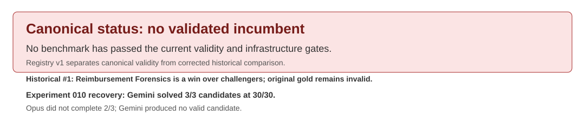

# BenchBench

BenchBench tests whether a model can create a benchmark package that strong
solvers cannot simply clear. A creator supplies public solver evidence, private
gold, a generator, verifier, scorer, and an explanation of likely failures.

## Current Result

**There is no validated incumbent.**

Reimbursement Forensics remains the **#1 corrected historical candidate** and
counts as a win over the later challengers. Recomputing its gold with Decimal
half-up arithmetic and rescoring the retained predictions gives `12/30,
16/30, 11/30, 13/30, 11/30, 11/30`: all six scores remain low and nonzero,
while later challenger rows reach at least `25/30`, are invalid, or are
incomplete. No model was rerun for this comparison.

That historical win is not a canonical promotion. The original Reimbursement
Forensics run remains invalid because its emitted gold violated Decimal
half-up rounding. Service Credit Forensics is also invalid because its public
evidence and gold use conflicting precedence rules. The Fable creator run is
incomplete: GPT-5.2 had a provider error and Claude Opus timed out. Those are
execution states, not `0/30` results.

### Modern Frontier Matrix (Score & Token Efficiency, Python Enabled)

Evaluating the five current-generation frontier models (**Gemini 4 Carbon** and **Gemini 4 Argon** via Antigravity, **Claude Opus 5.5** via Cursor, **GPT-6-Sol** via Codex, and **GLM 5.2 (High)** via Cursor) with full Python tool execution across all seven active benchmarks—including the repaired **Reimbursement Forensics v2 (`Experiment 015`)** under the actual policy and Gemini 4 Carbon's newly authored **HolonomyWeave (`Experiment 016`)**:

| Benchmark | Creator | Gemini 4 Carbon (`agy`) | Gemini 4 Argon (`agy`) | Claude Opus 5.5 (`cursor`) | GPT-6-Sol (`codex`) | GLM 5.2 High (`cursor`) |
|---|---|---:|---:|---:|---:|---:|
| **Reimbursement Forensics v2 (`015`)** | GPT-5.2 (repaired) | **30/30** (`165.6k` tok) | **30/30** (`283.4k` tok) | **30/30** (`281.8k` tok) | **30/30** (`45.7k` tok) | **30/30** (`736.8k` tok) |
| **AuditWeave (`010`)** | GPT-5.6 Sol | **30/30** (`84.9k` tok) | **30/30** (`478.8k` tok\*) | **30/30** (`251.0k` tok) | **30/30** (`34.7k` tok) | **30/30** (`93.5k` tok) |
| **Counterfactual Firewall Policy Synthesis (`010`)** | GPT-5.6 Terra | **30/30** (`245.9k` tok) | **30/30** (`202.8k` tok\*) | **30/30** (`257.3k` tok) | **30/30** (`28.8k` tok) | **30/30** (`221.1k` tok) |
| **Consolidation Point (`010`)** | Claude Opus 5 | **30/30** (`87.7k` tok) | **30/30** (`116.2k` tok) | **30/30** (`73.4k` tok) | **30/30** (`35.9k` tok) | **29/30** (`208.0k` tok) |
| **CloudSLA-Forensics (`013`)** | Gemini 3.7 Flash | **30/30** (`184.1k` tok) | **30/30** (`507.5k` tok) | **30/30** (`501.0k` tok) | **30/30** (`67.7k` tok) | **30/30** (`651.4k` tok) |
| **Maritime General Average Forensics (`014`)** | Gemini 4 Argon | **30/30** (`139.1k` tok) | **30/30** (`147.4k` tok) | **30/30** (`216.7k` tok) | **30/30** (`67.9k` tok) | **30/30** (`905.1k` tok) |
| **HolonomyWeave (`016`)** | Gemini 4 Carbon | **30/30** (`62.2k` tok) | **30/30** (`56.4k` tok) | **30/30** (`151.7k` tok) | **30/30** (`23.7k` tok) | **30/30** (`194.4k` tok) |
| **Total Score (Accuracy)** | — | **210/210 (`100.0%`)** | **210/210 (`100.0%`)** | **210/210 (`100.0%`)** | **210/210 (`100.0%`)** | **209/210 (`99.5%`)** |
| **Total Reported Tokens (`tokens / correct`)** | — | **`970k` (`4.6k/item`)** | **`1,793k` (`8.5k/item`)** | **`1,733k` (`8.3k/item`)** | **`304k` (`1.5k/item`)** | **`3,010k` (`14.4k/item`)** |

\*On `AuditWeave` and `CFPS`, Gemini 4 Argon's initial `agy --print` invocation (under its pre-release alias `halcyon`) delegated to async subagents (exiting the single-turn stream early) and solved both `30/30` when run synchronously in single-turn mode. Note: When Python execution was disabled, `Gemini 4 Carbon` still solved `015`, `014`, `013`, and `Consolidation Point` at `30/30` (`120/120` by hand) and `Claude Opus 5.5` solved `015`, `014`, and `013` at `30/30`, whereas `GLM 5.2 (High)` dropped to `17/30` on `015`, `24/30` on `014`, `29/30` on `013`, and timed out on `AuditWeave` and `CFPS`.

#### Solver Leaderboard (All 7 Active Benchmarks, 210 Items)

| Rank | Model (`Provider`) | Total Score | Accuracy | Total Reported Tokens | Reported Tok / Correct | Non-Cache (`In+Out`) Tokens | No-Python Stress Test (`013`+`014`+`015`) |
| :---: | :--- | :---: | :---: | ---: | ---: | ---: | :---: |
| **1** | **GPT-6-Sol High** (`codex:gpt-6-sol@high`) | **210 / 210** | **100.0%** | **`304,495`** | **`1,450`** | `304,495` (`1,450`/item) | — |
| **2** | **Gemini 4 Carbon High** (`agy:gemini-4-carbon-high`) | **210 / 210** | **100.0%** | **`969,521`** | **`4,617`** | `969,521` (`4,617`/item) | **90 / 90 (`100.0%`)** |
| **3** | **Claude Opus 5.5 High** (`cursor:claude-opus-5-5-high`) | **210 / 210** | **100.0%** | **`1,732,765`** | **`8,251`** | **`38,007` (`181`/item)** | **90 / 90 (`100.0%`)** |
| **4** | **Gemini 4 Argon High** (`agy:gemini-4-argon-high`) | **210 / 210** | **100.0%** | **`1,792,648`** | **`8,536`** | `1,792,648` (`8,536`/item) | — |
| **5** | **GLM 5.2 High** (`cursor:glm-5-2-high`) | **209 / 210** | **99.5%** | **`3,010,260`** | **`14,403`** | `295,444` (`1,414`/item) | **70 / 90 (`77.8%`)** |

#### Benchmark / Creator Difficulty Leaderboard (5 Frontier Solvers)

| Rank | Benchmark | Creator Model | Frontier Panel Score (Python On) | No-Python GLM 5.2 Score | Total Tokens Forced Across 5 Frontier Solvers | Avg Tokens / Solver |
| :---: | :--- | :--- | :---: | :---: | ---: | ---: |
| **1** | **Consolidation Point (`010`)** | **Claude Opus 5.5** | **149 / 150 (`99.3%`)** | `29 / 30` | `521,218` | `104.2k` |
| **2** | **CloudSLA-Forensics (`013`)** | **Gemini 3.7 Flash** | **150 / 150 (`100.0%`)** | `29 / 30` | **`1,911,667`** | **`382.3k`** |
| **3** | **Reimbursement Forensics v2 (`015`)** | **GPT-5.2** (repaired) | **150 / 150 (`100.0%`)** | **`17 / 30`** | **`1,513,387`** | **`302.7k`** |
| **4** | **Maritime General Average Forensics (`014`)** | **Gemini 4 Argon** | **150 / 150 (`100.0%`)** | **`24 / 30`** | **`1,476,235`** | **`295.2k`** |
| **5** | **Counterfactual Firewall Policy Synthesis (`010`)** | **GPT-5.6-Terra** | **150 / 150 (`100.0%`)** | Timeout | `955,878` | `191.2k` |
| **6** | **AuditWeave (`010`)** | **GPT-5.6-Sol** | **150 / 150 (`100.0%`)** | Timeout | `942,953` | `188.6k` |
| **7** | **HolonomyWeave (`016`)** | **Gemini 4 Carbon** | **150 / 150 (`100.0%`)** | — | `488,351` | `97.7k` |

Why did historical **Reimbursement Forensics (`Experiment 004`)** originally look hard (`11/30`–`16/30`)? Direct code audit of `generator.py` and `verifier.py` ([`experiments/adjudications/004_reimbursement_forensics.md`](experiments/adjudications/004_reimbursement_forensics.md)) showed that `APPROVAL_RE` double-escaped `\s` and restricted receipt IDs to uppercase `[A-Z0-9_\-]+`, matching `0/30` lowercase `reifor_xxxx_Ry` email approvals. When `APPROVAL_RE` is fixed and `amount` and `tip` are converted to USD cents per `policy.md` (`Experiment 015`), all five current-generation models (`Gemini 4 Carbon`, `Gemini 4 Argon`, `Claude Opus 5.5`, `GPT-6-Sol`, and `GLM 5.2 High`) solve it at **`30/30` (`100%`)** when Python is enabled.

The complete, digest-backed record is in
[`experiments/registry.v1.json`](experiments/registry.v1.json). The generated
canonical view preserves historical numbers as noncanonical evidence and
promotes nothing without a fresh validated run:
[`experiments/canonical/README.md`](experiments/canonical/README.md).

## What BenchBench Measures

A valid candidate needs more than low scores. It needs public evidence that
supports every answer, a private gold path that follows the public rules,
deterministic scoring, complete successful solver cells, and an execution
environment that keeps private material inaccessible to solvers.

That is why a `0/30` can mean several different things: hard task, invalid
gold, provider error, timeout, malformed output, or an incomplete panel. Only
the first can contribute to a benchmark claim, and only after adjudication.

## Next Run

The current modern frontier panel (`benchbench.frontier-modern/2026-11-10`)
comprises **Gemini 4 Carbon High** and **Gemini 4 Argon High** (`agy`), **GPT-6-Sol
High** (`codex`), **Claude Opus 5.5 High** (`cursor`), and **GLM 5.2 High**
(`cursor`). Outer-Seatbelt live boundaries are active across Antigravity (`agy`),
Codex (`codex`), and Cursor (`cursor-agent`) when
`BENCHBENCH_ALLOW_HOST_PROVIDER_SANDBOX=1` is set. Exact commands and safety
limits are in [`docs/running.md`](docs/running.md).

Treat Reimbursement Forensics as the historical target to beat, not as a
validated incumbent or reusable benchmark package. Do not reuse Service Credit
Forensics as an incumbent, and do not backfill failed solver cells as scores.
Historical run folders remain immutable; solver extensions publish into new
overlay roots.

The required historical resolutions are in:

- [`experiments/adjudications/004_reimbursement_forensics.md`](experiments/adjudications/004_reimbursement_forensics.md)
- [`experiments/adjudications/007_service_credit_forensics.md`](experiments/adjudications/007_service_credit_forensics.md)
- [`experiments/adjudications/008_fable_creator_sweep.md`](experiments/adjudications/008_fable_creator_sweep.md)
- [`experiments/adjudications/010_four_model_panel.md`](experiments/adjudications/010_four_model_panel.md)
- [`experiments/adjudications/010_provider_recovery_20260802.md`](experiments/adjudications/010_provider_recovery_20260802.md)
- [`experiments/adjudications/013_gemini_37_flash.md`](experiments/adjudications/013_gemini_37_flash.md)
- [`experiments/adjudications/014_halcyon.md`](experiments/adjudications/014_halcyon.md)
- [`experiments/adjudications/016_gemini_4_carbon.md`](experiments/adjudications/016_gemini_4_carbon.md)

## Repo Map

- `run_broad_three_model_sweep.py`: creator/solver sweep harness.
- `benchbench_model_backends.py`: provider dispatch.
- `benchbench_results.py`: prediction and score parsing.
- `experiments/registry.v1.json`: authoritative experiment and adjudication registry.
- `scripts/build_6x6_result_artifacts.py`: deterministic canonical-status generator.
- `scripts/prepare_public_evidence.py`: public-evidence sanitizer and digest rebinder.
- `scripts/build_benchmark_landscape_pack.py`: landscape pack builder.
- `docs/methodology.md`: evaluation method.
